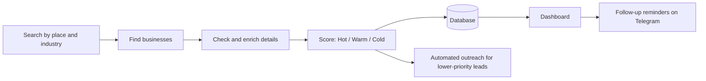
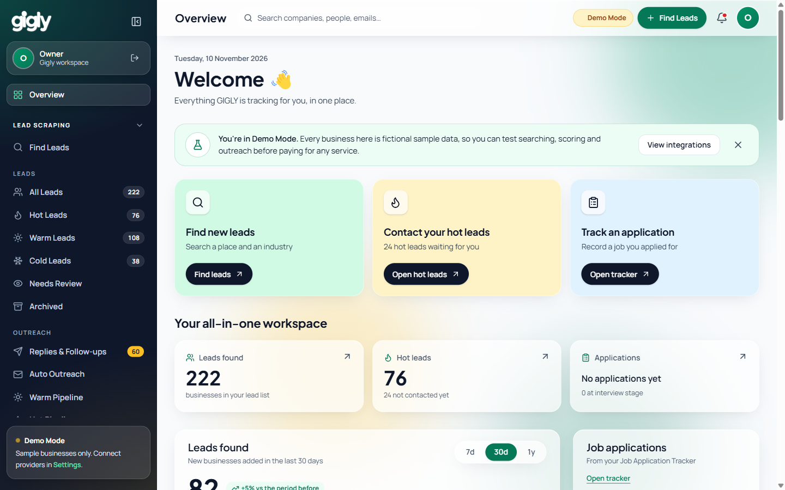
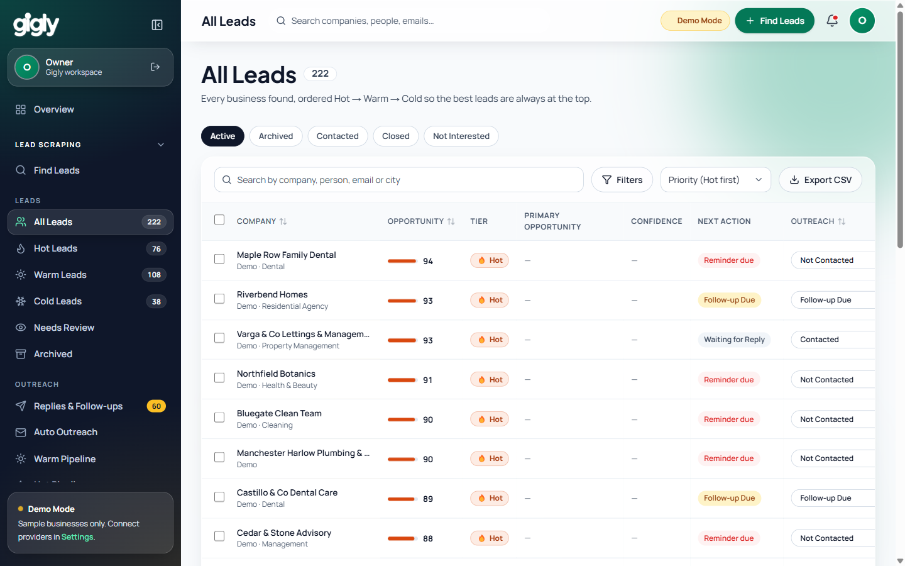

# AI Lead Generation System

**A system that finds businesses that need your service, scores every one, helps you reach out, and reminds you to follow up, all from one dashboard.**

    

---

## The problem

Finding new customers usually means hours of searching, copying details into spreadsheets, guessing who is worth contacting, and then forgetting to follow up. Good leads go cold while time is spent on the wrong ones.

## Who it's for

Founders, agencies and sales teams who sell to local or small businesses and want a steady flow of well-qualified leads without the manual research.

## What it does

- **Lead finding:** search by place and industry and get a list of real businesses, with contact details where available
- **Lead scoring:** every business is ranked **Hot, Warm or Cold**, so the best opportunities are always at the top
- **Automated outreach:** a first message can go out automatically to lower-priority leads, off by default, with a review-first option so nothing is sent without approval
- **Follow-up reminders:** instant Telegram reminders when a hot lead hasn't been contacted or a follow-up is due
- **One dashboard:** track every lead from "not contacted" to "closed", filter, search and export

## How it works

Searches run in the background. Every business is checked, enriched and scored before it appears in the dashboard, and the dashboard shows what to do next for each lead.

## Screenshots

*Both screenshots use fictional sample data in the system's Demo Mode. The dashboard is shown under its working name, Gigly.*

**Overview dashboard**

**Leads list, ranked Hot first**

## Results

*Real-world results (leads found, time saved, reply rates) will be added here once confirmed.*

## Built with

`n8n` · `Supabase` · `Telegram Bot` · `Next.js` · `TypeScript` · `Tailwind CSS`

## Live demo

**[Open the live demo](https://gigly.walkflow.tech/)** (private)

Access is protected. To view it, ask me for access and I'll send you a one-time password. Contact me via [walkflow.tech](https://walkflow.tech) or [LinkedIn](https://linkedin.com/in/walkflow).

## Want something like this?

I build automations like this for businesses: lead capture, follow-ups, and alerts. Get in touch at [walkflow.tech](https://walkflow.tech) or on [LinkedIn](https://linkedin.com/in/walkflow).

---

This repository is a showcase. A live demo is available on request — contact me via walkflow.tech or LinkedIn.
